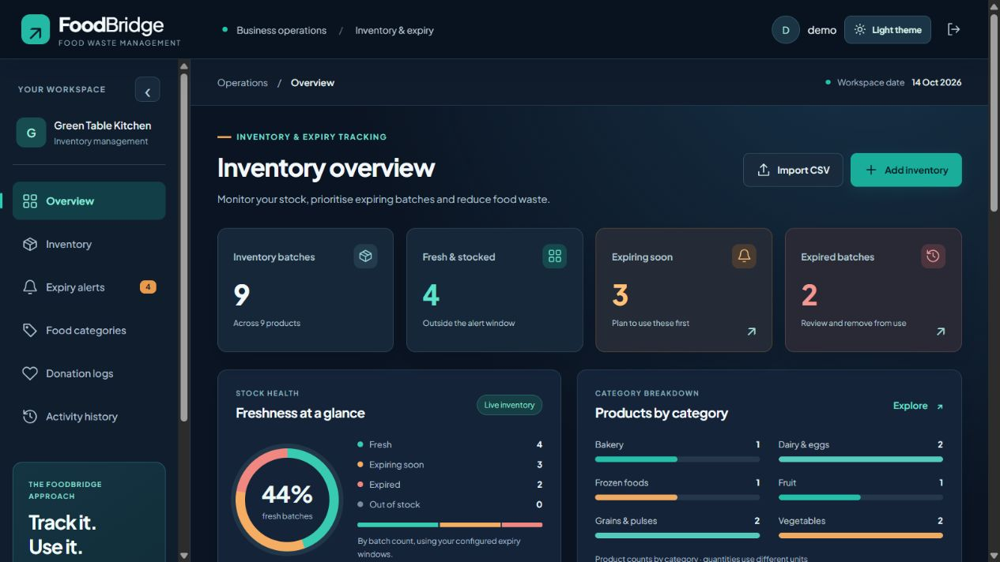

# FoodBridge — Milestone 1

Inventory Management & Expiry Tracking for the **AI-Powered Food Waste Management Platform for Surplus Identification and Redistribution Optimization**. This repository implements the supplied project brief's **Weeks 1–2** using Django, Django REST Framework, SQLite and a responsive web dashboard.

## Navigation and dashboard

FoodBridge offers two palettes: Food Rescue Marketplace (deep navy, teal and warm orange) and the original white official interface. Use the theme button beside your profile on the dashboard or in the upper-right corner of the sign-in page; your choice is remembered in this browser. Live stock-condition and product-category charts use actual inventory data. Use the arrow at the top of the sidebar to collapse it into an icon rail or expand it again. Your desktop sidebar preference is also remembered on this browser. On phones, use the menu button to open the navigation drawer; close it with the × button, outside area or Escape.

## What is included

- Sign-in and business-scoped inventory. Each account belongs to one business; users in different businesses cannot access each other's records.
- Product catalog, reusable SKUs and barcodes, stock batches, quantities, received dates, expiry dates and storage locations.
- Inventory CRUD, stock adjustments, search, category/status filters and pagination.
- CSV bulk import with validation and complete rollback if any row fails.
- Internal REST APIs and token authentication for POS clients, with idempotent stock adjustments.
- A seeded, read-only food taxonomy with perishability and storage guidance.
- Barcode/QR scanning from a camera or image, plus USB-scanner/typed-code lookup, using a locally bundled scanner library.
- Per-business and per-batch expiry thresholds, persisted in-app alerts, acknowledgement, and automatic refresh.
- Stock transaction history and completed donation logs that reduce stock and survive deletion of a batch.
- A local expiry watcher, plus Celery/Redis configuration for scheduled operation.
- Automated tests, demo data, API documentation and a milestone/demo checklist.

The Week 3–4 AI forecasting service and Week 5–6 matching marketplace, pickup scheduling and React dashboards are future modules. There are no external AI API dependencies in this milestone.

## Quick start on Windows

Use **Python 3.12**. Run these commands from the project folder in PowerShell. The default SQLite database needs no separate database service.

```powershell
py -3.12 -m venv .venv
.\.venv\Scripts\python.exe -m pip install -r requirements.txt
Copy-Item .env.example .env
.\.venv\Scripts\python.exe manage.py migrate
.\.venv\Scripts\python.exe manage.py seed_demo
```

The demo command prints a **randomly generated password** for username `demo`. Save it locally. Running it again does not reset data or credentials. If needed, reset the local demo password interactively:

```powershell
.\.venv\Scripts\python.exe manage.py changepassword demo
```

Start the dashboard and the expiry watcher together:

```powershell
.\start.ps1
```

Open **http://127.0.0.1:8000/** and sign in. Keep the terminal running. The watcher checks expiry every 60 seconds, even if the browser is closed. Ctrl+C stops the server and watcher. To use another port: `.\start.ps1 -Port 8001`.

If PowerShell blocks script execution, there is no need to change the machine policy. Run the following in two terminals instead:

```powershell
# Terminal 1
.\.venv\Scripts\python.exe manage.py runserver 127.0.0.1:8000
# Terminal 2
.\.venv\Scripts\python.exe manage.py check_expiry --watch --interval 60
```

On macOS/Linux, create a virtual environment with `python3.12 -m venv .venv`, then use `.venv/bin/python` in place of `.\.venv\Scripts\python.exe`. Start the server and watcher in two terminals as above.

If `py` is missing, install Python 3.12 or use the full path to an existing Python 3.12 executable. Virtual environments are machine-specific and should never be copied between computers or committed to Git.

## Real business accounts

```powershell
.\.venv\Scripts\python.exe manage.py create_business --name "My Kitchen" --username kitchen
```

This securely prompts for the new user's password. To provision additional members of the same business, create an administrator with `createsuperuser`, then use `/admin/` to create a user and a Membership. Every member has the same inventory permissions in this milestone. An administrator without a Membership can use Django admin but cannot access tenant APIs or the dashboard.

## CSV upload

Choose **Import CSV → Download the CSV template**. The template includes example dates generated for the current day. Edit the sample row before importing.

```csv
product_name,sku,barcode,category,unit,batch_number,quantity,received_date,expiry_date,storage_location,alert_days,notes
Tomatoes,TOM-002,8901234567890,vegetables,kg,TOM-002-A,12.500,2026-10-14,2026-10-19,Produce shelf,3,Example
```

Dates must be `YYYY-MM-DD`; expiry cannot precede receipt. Quantities allow three decimal places. Units: `kg`, `g`, `litre`, `unit`, `pack`. Category values use taxonomy **codes**, visible on the Food categories screen and `/api/categories/`. UTF-8, maximum 2 MB and 1,000 rows per upload. New SKUs create products; existing SKUs must match their catalog details. Duplicate product/batch combinations are rejected; importing is not an upsert.

## Scanning

Add a product's exact barcode or QR value to its catalog record. Select **Scan barcode / QR**, scan it or type it, then edit or adjust the matching batch. The bundled `html5-qrcode` library supports camera and image-based scanning. A code is an exact identifier, not an external product lookup or a URL to execute.

Phone cameras require a secure HTTPS origin. `localhost` works on the computer; a phone visiting a computer's plain HTTP LAN address generally cannot use its camera. Use an HTTPS development endpoint when testing on a physical phone. Image upload and typed/USB-scanner lookup remain available. Physical camera/device permission behavior must be checked on your target phone.

## Automated alerts

An in-stock batch is **expired** when expiry is before today; **expiring** when today through the configured threshold (inclusive); otherwise **fresh**. Zero stock is `out_of_stock`. An expiry date of today is still within the alert window. The default time zone is `Asia/Kolkata`; set `TIME_ZONE` in `.env` if required.

Alerts are created after stock changes, by the periodic watcher, and refreshed on dashboard reads. The dashboard polls every 60 seconds while visible. Acknowledgement marks an alert as read; it does not hide a still-risky batch. Resolving stock/expiry clears active alerts. Returning stock to an at-risk state or changing expiry severity reopens the alert.

For one check: `python manage.py check_expiry`. Run **one scheduling method** for a deployment: the local watcher, OS scheduler invoking `check_expiry`, or Celery Beat. The milestone notification channel is the in-app dashboard; email/SMS/push delivery is not included.

### Optional Celery and Redis

With Docker installed, `docker compose up -d redis` starts the localhost Redis broker. In two additional terminals with the virtual environment active:

```text
celery -A foodwaste worker --loglevel=info --pool=solo
celery -A foodwaste beat --loglevel=info
```

Beat queues an expiry refresh every hour. `--pool=solo` is suitable for a Windows development demo; use Linux workers for deployment. Broker-backed delivery needs an actual running Redis, worker and Beat. Task logic is covered by the test suite; the local watcher is the default runnable path.

## Checks

```powershell
.\.venv\Scripts\python.exe manage.py check
.\.venv\Scripts\python.exe manage.py makemigrations --check --dry-run
.\.venv\Scripts\python.exe manage.py test inventory
```

See [API reference](docs/API.md), [architecture](docs/ARCHITECTURE.md), [milestone checklist and demo](docs/MILESTONE_1.md), and [verification results](docs/VERIFICATION.md). CI runs checks automatically after you manually push the repository to GitHub.



## Project structure

```text
foodwaste/                  Django settings, URLs, WSGI and Celery
inventory/                  Models, serializers, permissions, API views and services
inventory/migrations/       Schema and food-taxonomy seed data
inventory/management/       Business provisioning, demo seed and expiry watcher
inventory/tests/            API, validation, tenant and workflow tests
templates/                  Sign-in and responsive dashboard
static/                     CSS, JavaScript and bundled scanner
docs/                       API, architecture, milestone checklist and demo
start.ps1                   Local server plus expiry watcher
```

## Manual GitHub handoff

The repository contains `.gitignore` entries for `.venv`, `.env`, the local SQLite database, logs, generated static files and QA artifacts. Create your repository and agreed branch, then inspect `git status` before adding files. Commit source files, migrations, documentation, `requirements.txt`, `.env.example`, and the scanner's license. No Git commit or push is performed by the application.

The supplied Word brief may be retained with the repository if your team is permitted to share it. Do not commit local demo credentials, real business data or access tokens. The app's development server and SQLite setup are for the milestone demo; public production deployment needs HTTPS, a strong secret, suitable app hosting, backups and a production database such as PostgreSQL.

## Dependency references

The implementation targets [Django 5.2 LTS](https://www.djangoproject.com/download/) and [Django REST Framework](https://www.django-rest-framework.org/). Camera/image scanning uses [html5-qrcode 2.3.8](https://scanapp.org/html5-qrcode-docs/docs/intro), bundled under the Apache 2.0 license at `static/vendor/html5-qrcode.LICENSE.txt`.
