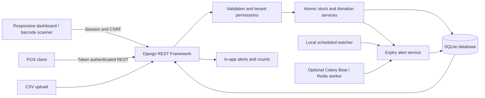
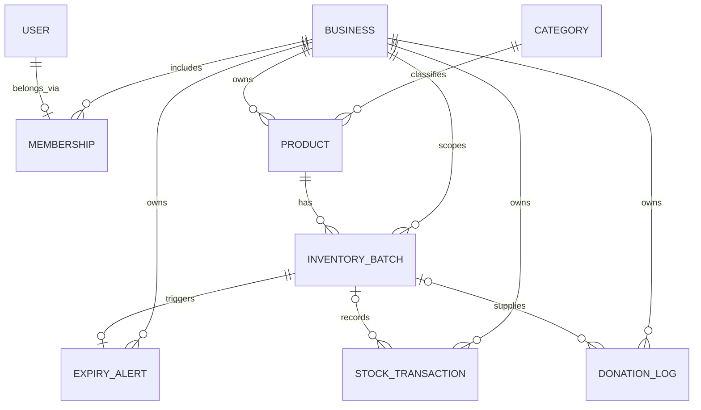

# Milestone 1 architecture

The first milestone delivers a working inventory system and the data foundation for later AI and redistribution modules. A single Django application serves a responsive dashboard and a REST API. The browser uses same-origin session authentication, while POS clients use tokens. SQLite keeps local setup simple; the ORM allows a later PostgreSQL migration.

## Database relationships

Each user has one business membership. Several users can share the same business. Categories are a global read-only taxonomy. Product SKU and nonempty barcode are unique within a business; batches are unique by business, product and batch number. Business IDs are assigned from the authenticated membership, never from client-selected scope. Related product/batch fields only accept objects belonging to that business.

## Stock integrity

Create, update, adjustment, delete, donation and CSV services use database transactions. Updates use a version check and conditional database write to detect concurrent changes. Stock cannot fall below zero. Transaction snapshots retain product identity, batch dates, notes, storage and units after batch deletion. Donation logs also retain a snapshot. POS transaction references deduplicate repeated adjustments.

CSV imports run in one transaction: a later invalid row rolls back earlier products, batches, alerts and history. Files are limited to 2 MB and 1,000 rows. Dates use ISO format and units allow a fixed set of values. Category codes are explicit; classification does not pretend to use an AI model.

## Expiry behavior

Dates are interpreted in the configured business deployment time zone (`Asia/Kolkata` by default). A batch threshold overrides the workspace default. The status sequence is zero stock → expired → within threshold → fresh. A persistent alert exists per batch; repeated checks update it instead of generating duplicates. Acknowledgement is separate from resolution. Expiry or severity changes and reopening risk clear acknowledgement.

The default Windows launcher runs a periodic expiry watcher alongside Django. Celery Beat and Redis provide an alternative scheduler. The dashboard also refreshes current alerts during reads and polls while visible. Notifications are in-app, with no external delivery provider required.

## Implementation boundaries

- This is a local milestone application, not a deployed production service. Production hosting needs HTTPS, PostgreSQL, centralized rate limiting, backups, logging and environment-specific security settings.
- Members of a business have equal permissions; role-based owner/staff access and invitation flows are future work. Trusted Django admins can provision memberships and taxonomy.
- Inventory status filtering currently evaluates per-batch thresholds in Python for portability. Large inventories should move this calculation into database expressions and add indexes after measuring query plans.
- SQLite serializes writes. Conditional updates reject stale clients, but large concurrent workloads require a production database and load testing.
- Codes identify existing products; no third-party barcode database or commercial POS adapter is included.
- The stock ledger retains operational history; it is not a tamper-proof compliance ledger against trusted database administrators.
- AI forecasting, risk scoring, NGO matching, reservations, pickup scheduling and impact estimates are outside Weeks 1–2.

## Decision on frontend stack

The supplied brief explicitly introduces React dashboards in Weeks 5–6. The first milestone uses Django templates and vanilla JavaScript to keep setup small and demonstrate the REST integration now. Later React clients can use the same tenant-scoped API rather than reimplementing inventory rules.
